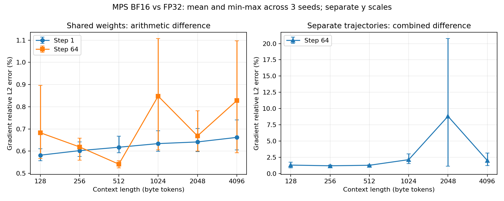
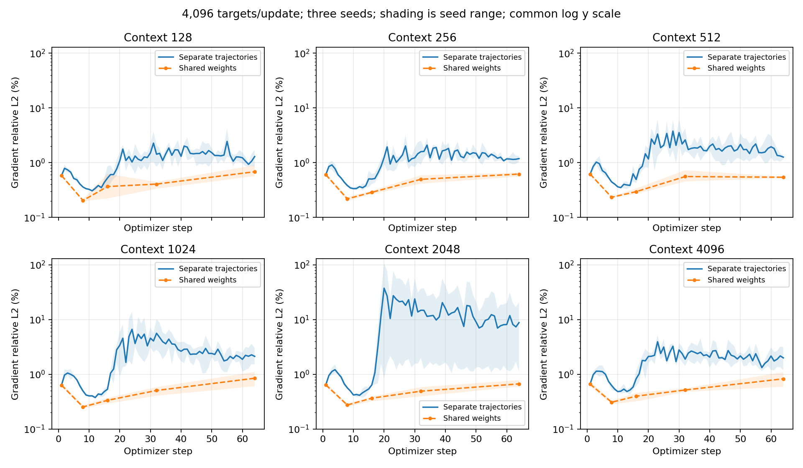
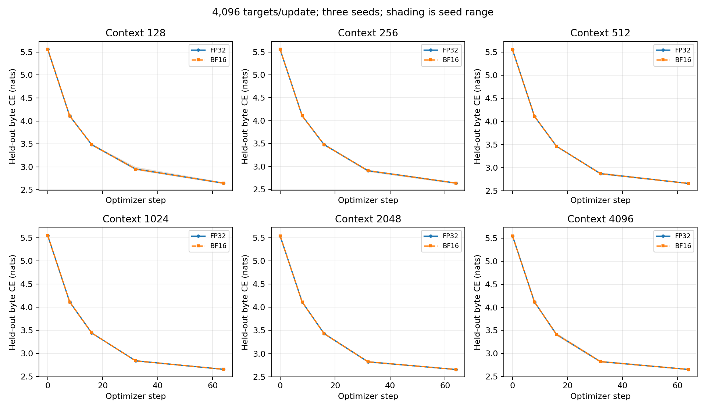

# Local context and gradient study: 128 to 4K

**Status: awaiting_review.** All 18 context/seed pairs completed. The 115
experimental-control checks passed; these checks do not grant numerical
acceptance. The earlier G0-local 10% first-update criterion remains unchanged
and unaccepted. Dependent next-stage work is paused for the user's review.

At identical weights, the initial mean BF16/FP32 gradient relative L2 difference
rose from 0.582% at context 128 to 0.662% at 4K. At the final step it was
0.593–1.097% across the three 4K seeds. Final differences were not monotonic in
context length. These observations do not show a sharp increase in same-weight
arithmetic error over the tested contexts. Independent training trajectories
were more sensitive: one 2K run reached a 107.3% gradient difference despite
similar validation losses. An exact replay isolates this case below.

## Configuration and controls

| Item | Configuration |
| --- | --- |
| Context lengths | 128, 256, 512, 1024, 2048, 4096 **byte tokens**, not subword tokens |
| Seeds | 17, 29, 43; paired FP32/BF16 initialization and data |
| Hardware/backend | Local Apple M5 Pro, 20 GPU cores, 48 GiB unified memory; both arms use MPS |
| Software | Python 3.12.14, PyTorch 2.15.0, macOS 26.6; [locked dependencies](../../../../tools/precision_local/requirements.lock) |
| Model | 3,541,248 parameters; 4 decoder blocks, width 256, 4 heads, FFN 768; RMSNorm, RoPE, SwiGLU, explicit causal attention; byte vocabulary 256 |
| Precision | FP32 parameters, parameter gradients and AdamW states in both arms; BF16 autocast for linear/attention GEMMs in the BF16 arm; norms, softmax, residuals and loss in FP32 |
| Training | 64 optimizer steps per arm; 4,096 target tokens/update; one sequence/microbatch; accumulation = 4096/context |
| Optimizer | AdamW; peak LR 0.0006; 8-step warmup; cosine decay to 10%; gradient clipping at norm 1; remaining settings in [base protocol](base_protocol.json) |
| Dropout | Disabled in both arms; this is a new controlled study, not a continuation of the earlier dropout-enabled run |
| Training budget | 262,144 targets/arm; 36 arms; 9,437,184 processed targets total, excluding probes and validation |
| Validation | Four fixed 4,096-target held-out windows, 16,384 targets total; evaluated at steps 0/8/16/32/64 |
| Gradient probes | All-step trajectory comparisons; same-weight probes at steps 1/8/16/32/64; before clipping |
| Determinism | Strict deterministic algorithms in each training process; CPU fallback and MPS fast math disabled |
| Memory guard | 60% of Metal's recommended working-set limit; no silent fallback |

Each update uses a shared 4,097-byte source span. Inputs and next-byte targets
are partitioned into independent sequences of the chosen length. Thus all
contexts see the same target tokens, window starts and target count for a given
seed/step. Positions reset within each sequence; attention cannot cross those
boundaries. Accumulation order also changes with sequence length.

Only the initial weights are identical across contexts. Later each context's
FP32 reference has learned under its own context boundaries. Consequently the
step-64 context comparison includes differences in reference weights, while
each FP32/BF16 same-weight comparison remains controlled within that context.

Data: the pinned Tiny Shakespeare file from the [base protocol](base_protocol.json),
1,115,394 bytes, SHA256
`86c4e6aa9db7c042ec79f339dcb96d42b0075e16b8fc2e86bf0ca57e2dc565ed`;
first 90% training, last 10% validation. The validation windows are identical
across contexts and seeds. Repeated training windows are allowed by the sampler.

## What the gradient numbers mean

Let `g32(w, x)` and `g16(w, x)` denote accumulated FP32 and BF16 gradients on
the same batch. All parameter gradients are flattened into one vector for
global relative L2; norms and diagnostic reductions use FP64 on CPU.

- **Same weights:** `||g16(w32, x) - g32(w32, x)|| / ||g32(w32, x)||`.
  Copy current FP32 weights into a separate BF16 probe model. This measures
  precision-path arithmetic differences at fixed weights and data. The probe
  never steps an optimizer or changes either training model.
- **Separate trajectories:** `||g16(w16, x) - g32(w32, x)|| / ||g32(w32, x)||`.
  Each arm has its own evolving weights. This includes both arithmetic
  differences and the effects of accumulated training divergence.

Every step records global and per-parameter norms, relative L2, cosine,
maximum absolute difference and gradient sign flips. The global statistic is
norm-weighted, so it cannot establish that every parameter tensor behaves
equally well. These are **gradient** differences, not the earlier isolated
AdamW **parameter-update** difference of 10.27%.

## Results

All percentages below are gradient relative L2. Means and ranges refer to
three seeds, not confidence intervals. The final validation gap is the largest
absolute paired loss difference across seeds, evaluating both learned models
in FP32 to remove evaluation-dtype differences.

| Context | Step 1, same weights, mean | Step 64, same weights, mean (range) | Step 64, separate trajectories, range | Max final validation gap, nats/byte |
| --- | --- | --- | --- | --- |
| 128 | 0.582% | 0.683% (0.568–0.896%) | 0.86–1.73% | 0.000219 |
| 256 | 0.602% | 0.619% (0.559–0.659%) | 1.04–1.32% | 0.000123 |
| 512 | 0.618% | 0.542% (0.525–0.557%) | 1.16–1.34% | 0.000597 |
| 1024 | 0.634% | 0.848% (0.606–1.107%) | 1.51–3.02% | 0.000275 |
| 2048 | 0.642% | 0.669% (0.600–0.782%) | 1.13–20.76% | 0.000692 |
| 4096 | 0.662% | 0.828% (0.593–1.097%) | 1.20–3.15% | 0.000087 |

Across all 90 predeclared same-weight probes, the largest global relative L2
difference was 1.107% (context 1024, seed 29, step 64). This is an observed
maximum over sampled steps, not a bound for unprobed steps or future training.

At 4K, the minimum final same-weight gradient cosine was 0.999944. The mean
gradient sign-flip fraction was 0.243% of parameter coordinates. Mean final
common-FP32 validation losses were 2.65453156 for FP32-trained weights and
2.65455391 for BF16-trained weights; the largest paired gap was 0.00008667.



The two panels use explicitly separate vertical scales. The larger independent
trajectory differences should not obscure the same-weight arithmetic trend.



All six history panels use the same logarithmic vertical scale. Lines show
seed means, shaded bands show min/max. Same-weight dashed lines connect only
the five measured probe steps; they do not imply measurements between them.



These curves evaluate each arm in its own precision; the final table instead
evaluates both learned models in FP32. Similar scalar losses do not imply
identical gradients or training trajectories. Loss averages prediction error
over tokens, while gradients measure parameter sensitivity; this experiment
directly demonstrates that their agreement can differ substantially.

## The 2K trajectory outlier

Context 2048, seed 43, step 20 had the largest trajectory difference in the
sweep: **107.313%**, with cosine **0.636719**. Its FP32 gradient norm was 0.858754
and BF16 trajectory gradient norm 1.187711, so this is not an almost-zero
reference norm causing an enormous ratio.

The explicitly post-run [replay protocol](peak_protocol.json) adds same-weight
probes at steps 19/20/21 and saves step-20 raw gradients, keeping training
settings unchanged. All original history fields, existing probes, validation,
final model tensors, optimizer tensors and CPU/MPS RNG states reproduced
**exactly**. [The replay evidence](peak_replay.json) records hashes and the
additional global/per-parameter measurements.

| Step | Separate trajectories | Same weights |
| --- | --- | --- |
| 19 | 30.785% | 0.657% |
| 20 | 107.313% | 0.584% |
| 21 | 76.916% | 0.395% |
| 32 | 36.665% | 0.395% |
| 64 | 20.764% | 0.782% |

At step 20 the two parameter vectors differed by only **0.1113% relative L2**.
The same-weight gradient cosine was 0.999983, with 0.169% sign flips; across
the actual trajectories, 16.865% of gradient coordinates had flipped sign.

Using the same denominator `||g32(w32)||`, the raw-gradient decomposition is:

```text
g16(w16) - g32(w32)
  = [g16(w16) - g16(w32)] + [g16(w32) - g32(w32)]
       weight-dependent term       arithmetic term

total norm / reference norm:             107.3134%
weight-dependent norm / reference norm:  107.5793%
arithmetic norm / reference norm:          0.5840%
```

The terms have a signed cross term and their norms are not additive. This
diagnostic shows that the large step-20 discrepancy is dominated by evaluating
gradients at different learned weights, rather than a 107% arithmetic error
at identical weights. It does **not** make trajectory drift harmless: small
precision perturbations can accumulate into a locally sensitive trajectory.
The first embedding tensor and block-0 QKV tensor contributed 44.64% and 21.29%
of total trajectory gradient-error energy at this step.

The final common-FP32 validation gap for this seed was 0.00069216 nats/byte.
The present data do not establish which optimizer dynamics or model component
caused the amplification, nor whether it matters over a long training horizon.

## Validation, limitations and review decision

- The pre-existing 34 harness tests passed before the sweep. Eight additional
  replay-checker tests passed, including rejection of changed existing probes,
  trajectories, final weights, optimizer/RNG tensors and missing steps.
- All 115 sweep controls passed: complete context/seed and step/probe coverage,
  shared initialization/window identities, constant budgets, source consistency,
  finite metrics and initial probe/trajectory equality. These are control
  checks, not statistical equivalence tests or numerical acceptance thresholds.
- Replay comparison checked raw gradients against logged metrics and exact
  reproduction of the original numerical trajectory and checkpoint state.
- Changed Python was checked with Black, isort and Ruff; plots were rendered
  and visually inspected. The root CUDA stack was not modified or executed.
- At 4K, the largest sampled live MPS allocation was 2.14 GiB and driver
  allocation 3.16 GiB. Samples around forward/backward calls can miss transient
  peaks; they are not true peak-memory measurements. Instrumented runtimes
  include gradient copies, probes and validation and are not speed benchmarks.
- This is a 3.54M-parameter, 64-step, byte-level local reference study. It does
  not establish 4K subword-token behavior, long-horizon convergence, H20/CUDA/TE
  correctness, distributed behavior, or FP8/FP4 accuracy/performance.

**Proposed interpretation for review:** the local harness completed the 4K
extension with reproducible evidence. Sampled same-weight arithmetic errors
remain around 1% or less, with a maximum of 1.107%; independent training
trajectories can diverge much more. No new numerical threshold was selected,
and no acceptance is inferred from the similar validation curves. Await the
user's decision before progressing to a subsequent precision milestone.

## Evidence and reproduction

- [Original context protocol](protocol.json), [base protocol](base_protocol.json),
  [run manifest](manifest.json), [provenance and hashes](provenance.json).
- [Summary](summary.json): every control result, seed-level validation/probes,
  source revisions and raw-artifact hashes.
- [Global gradient history](gradient_history.csv): 1,242 records, comprising
  1,152 trajectory measurements and 90 same-weight probes.
- [Per-parameter same-weight probes](parameter_probes.csv): 2,790 records.
  Complete all-step per-parameter trajectory data remain in raw `gradients.jsonl`.
- [Post-run peak replay](peak_replay.json) and [its protocol](peak_protocol.json).
- Raw suite: `local/precision/runs/context-4k-v1/` (about 2.4 GB); raw replay:
  `local/precision/runs/context-2k-peak-replay-v1/`. These are local ignored
  artifacts, not uploaded durable remote storage. Retain them for later audit.

Training used clean source `b42b3e696184c8030bb6e11567bf86fe52536f2a`.
The targeted replay used clean source `c4177ae8d` with identical training code.
Plot layout changed in `2108bd747`; the replay checker is in `6d4501571`.
Exact revisions, protocol hashes and evidence hashes are in `provenance.json`.
The suite launcher records deterministic mode before initialization; every
actual run records it enabled after configuration.

Run from the repository root, using the isolated environment described in the
[harness README](../../../../tools/precision_local/README.md):

```bash
local/precision/.venv/bin/python tools/precision_local/context_sweep.py suite \
  --out local/precision/runs/context-4k-v1
local/precision/.venv/bin/python tools/precision_local/summarize_context.py \
  local/precision/runs/context-4k-v1
local/precision/.venv/bin/python tools/precision_local/context_sweep.py run \
  --protocol tools/precision_local/context_peak_protocol.json \
  --context 2048 --seed 43 \
  --out local/precision/runs/context-2k-peak-replay-v1
local/precision/.venv/bin/python tools/precision_local/compare_context_replay.py \
  local/precision/runs/context-4k-v1/context-2048-seed-43 \
  local/precision/runs/context-2k-peak-replay-v1 --step 20 \
  --out local/precision/runs/context-2k-peak-replay-v1/comparison.json
```

Use fresh output paths when reproducing. Preserve the committed report and
original protocol; new observations must not overwrite accepted provenance.
