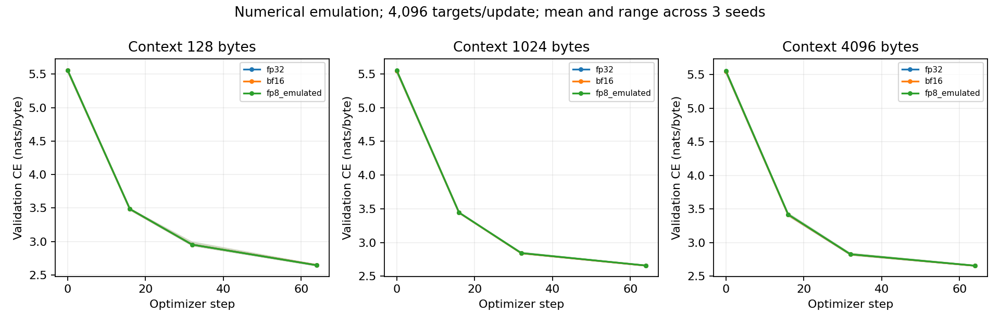
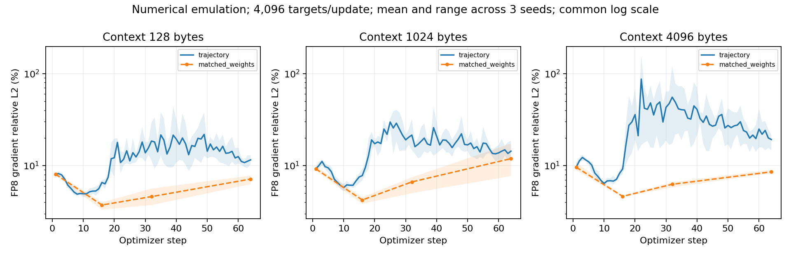

# Local FP8 numerical emulation and training integration

**Status: `passed_pending_batch_review`.** The predeclared local engineering
checks passed and evidence is retained for the user's later batch review.
Under the updated instruction there is no individual approval stop. This does
not grant user acceptance or replace H20/Transformer Engine validation. The
earlier G0-local failed update criterion is unchanged.

## Implemented behavior

The independent [FP8 implementation](../../../../tools/precision_local/fp8.py)
rounds activations and weights to E4M3FN and output gradients to E5M2. Each
tensor uses a current-amax power-of-two dequantization scale. Rounding is
nearest, ties to even, with FP8 subnormals and finite saturation. NaN/Inf,
unsupported FP32 scale ranges and dequantization overflow fail explicitly.
All quantized values are dequantized into FP32 storage for FP32 GEMMs on MPS.
This is **numerical emulation**, not native FP8 compute or a TE kernel replica.

For each linear layer, the three paths are:

```text
forward: y  = Q4(x) @ Q4(w).T
dgrad:   dx = Q5(dy) @ Q4(w)
wgrad:   dw = Q5(dy).T @ Q4(x)
```

The backward is a declared training surrogate, not a derivative of the rounding
function. Higher-order derivatives are unsupported. The five projections in
each of four decoder blocks are replaced (20 modules). Embedding, output head,
attention GEMMs, RMSNorm, residuals and loss remain FP32. Parameters, accumulated
gradients and AdamW states remain FP32. Existing parameter identities and
checkpoint keys are preserved, including when installing after optimizer setup.

The format/current-scaling concepts follow the
[official TE documentation](https://nvidia.github.io/TransformerEngine/features/low_precision_training/fp8_current_scaling/fp8_current_scaling.html).
The power-of-two scales, FP32 computation and module coverage are explicit
local choices. Per-tensor amax can couple quantization across tokens even though
attention is causal; changing a later token can slightly change an earlier
token's quantized representation. No native speed or memory claim follows.

## Predeclared experiment

[The protocol](protocol.json) was committed before scored measurements. It
pins the earlier [base configuration](base_protocol.json) by SHA256.

| Item | Value |
| --- | --- |
| Platform | Apple M5 Pro, 20 GPU cores, 48 GiB unified memory; MPS |
| Environment | Python 3.12.14, PyTorch 2.15.0, macOS 26.6; isolated hash-locked environment |
| Controls | Deterministic algorithms enabled, MPS fallback/fast math disabled; fresh process per run |
| Model/data | Same 3,541,248-parameter byte decoder and pinned Tiny Shakespeare split as the preceding context study |
| Contexts/seeds | 128, 1024, 4096 byte tokens; seeds 17, 29, 43 |
| Training arms | FP32, BF16 autocast, FP8 numerical emulation |
| Budget | 64 steps; 4,096 targets/update; one sequence/microbatch; accumulation = 4096/context |
| Dropout/optimizer | Dropout 0; unchanged AdamW, clipping at norm 1, 8-step warmup and cosine schedule |
| Training targets | 262,144/arm; 27 main arms; 7,077,888 total main-run targets |
| Probes | Steps 1/16/32/64: same-weight gradients, same-weight/same-AdamW-state updates, operand quantization statistics |
| Validation | Four fixed 4,096-target held-out windows; steps 0/16/32/64; final common-FP32 evaluation |
| Checkpoints | Step 32 and final; exact fresh-process repeat/resume for all three arms at context 128, seed 17 |

Every context uses the same 4,097-byte input/target span at a given seed/step.
Only the partition into independent causal sequences changes; positions reset
within each sequence. Step-1 initial weights are common across contexts, but
later reference weights have learned under their respective context boundaries.

The predeclared operator bounds separate implementation error at identical
quantized operands (relative L2 <= 1e-5) from quantization versus FP64 unquantized
GEMMs (forward <= 0.08, dgrad/wgrad <= 0.12). Training checks require same-weight
global gradient relative L2 <= 0.20 at declared probes, validation improvement
>= 0.3, and final paired loss gaps <= 0.1, plus finiteness and exact replay.
These are bounded local engineering checks, not universal accuracy thresholds.
No bound was added or relaxed after observing results.

## Operator and quantizer evidence

The independent oracle uses CPU native float8 casts and FP64 matrix products.
Tests enumerate all finite float8 encodings, every adjacent midpoint and its
FP32 nextafter neighbors, signed zero, random values and extremes. CPU and
MPS quantizer results match the finite saturating cast oracle exactly.

The scored operator matrix has three `(M,K,N)` shapes and three seeds: nine
cases, each checking forward, dgrad, wgrad, operand identity and exact repeat.

| Path | Largest same-quantized-operand GEMM relative L2 | Largest quantization relative L2 |
| --- | --- | --- |
| Forward | 3.4760e-8 | 3.7807% |
| Input gradient | 2.5845e-8 | 6.1637% |
| Weight gradient | 2.0023e-8 | 6.2995% |

All 90 operator checks passed. This checks FP32 MPS multiplication of quantized
operands, not the accumulation behavior of an H20 FP8 Tensor Core kernel.

## Full-model and training evidence

Relative L2 is `||candidate-reference|| / ||reference||`, reduced in FP64 on CPU.
Gradient measurements are after accumulation and before clipping. Same-weight
probes copy the current FP32 model into an independent FP8-emulated model.
Optimizer probes also copy the FP32 AdamW state, then apply the actual learning
rate and clipping to both steps. They do not mutate the training reference.

| Context | Initial same-weight gradient, mean | Final same-weight gradient, mean (seed range) | Final same-state update, seed range | Max final common-FP32 loss gap |
| --- | --- | --- | --- | --- |
| 128 | 8.068% | 7.132% (6.268–7.783%) | 2.364–2.687% | 0.0046051 |
| 1024 | 9.199% | 11.896% (7.689–17.351%) | 3.194–5.707% | 0.0023611 |
| 4096 | 9.597% | 8.545% (8.265–9.003%) | 3.891–4.582% | 0.0041023 |

The largest declared same-weight gradient difference is 17.3506% at context
1024, seed 17, step 64. Initial same-state AdamW update differences are much
larger, **37.997–42.826%**, and are preserved as diagnostics. No update-error
acceptance bound was declared for this FP8 study; these values must not be
described as passing the earlier G0-local 10% criterion. The final update
comparisons above use the reference optimizer's accumulated history, not the
independent FP8 optimizer history.

At the sampled quantization probes, saturation counts are zero. The largest
fraction of nonzero operand values rounded to zero is 0.1312% for a recorded
module/operand aggregate. Statistics are sampled at probe steps, not every
training step; they do not bound unobserved behavior.





Lines show three-seed means and shading shows min/max, not confidence intervals.
Gradient panels share a logarithmic scale. Dashed lines connect measured
same-weight probes; they do not imply measurements between probes. Validation
curves use each arm's execution precision. The table evaluates all learned
weights in FP32 with FP8 emulation disabled. The largest final execution-loss
gap is 0.0045935 nats/byte. Similar losses do not establish identical gradients
or long-horizon convergence.

## Trajectory-peak diagnostic

The largest independent-trajectory gradient difference was **158.3455%** at
context 4096, seed 17, step 22. The separately declared post-run
[peak protocol](peak_protocol.json) adds a same-weight probe at that step.
It reproduces all original history fields, validation, model/optimizer tensors
and CPU/MPS RNG states exactly. The same-weight difference at the peak is
**6.9483%**.

The [replay checker](../../../../tools/precision_local/fp8_replay.py) uses the
triangle inequalities to bound
`||g8(w8)-g8(w32)|| / ||g32(w32)||` between **151.3972% and 165.2938%**.
This establishes that evaluating the gradient at different learned weights
dominates this peak relative to its same-weight arithmetic term. It is a norm
bound, not a measured vector-energy decomposition. The specific dynamics that
amplify small weight perturbations, and their long-run effect, remain open.

## Validation and limitations

- 359/359 combined operator/training/control checks passed, with no threshold
  changes. All three arms repeat and resume exactly in fresh processes at the
  declared replay context/seed. This does not assert replay coverage at all
  contexts or on other hardware.
- 126/126 additional cross-study checks show the FP32/BF16 controls match the
  prior context study exactly: windows, initialization, per-step losses/norms,
  BF16 global/per-parameter gradient metrics, final validation and model/optimizer
  tensors. Cross-study RNG states are not compared because this study constructs
  extra models. Its own repeat/resume checks do include RNG states.
- The full 67-test harness suite passed, followed by two additional targeted
  replay tests. Tests include quantizer boundaries, independent linear backward
  formulas, parameter identity, optimizer-probe isolation and mutation-sensitive
  rejection of missing/changed evidence.
- Changed Python passed Black, isort and Ruff. Plots were rendered and visually
  inspected. The repository formatter reported no changed CUDA/core/test files.
- This is short training of a tiny byte-level model, with FP32 GEMMs and
  synchronous diagnostic operations. It cannot establish native FP8 performance,
  H20/TE numerical parity, distributed correctness, FP4 accuracy or production
  training convergence. All of those gates remain separate.

## Evidence, provenance and reproduction

- [Summary and checks](summary.json), [operator results](operators.json),
  [repeat/resume](replay.json), [cross-study controls](baseline_crosscheck.json),
  [targeted peak replay](peak_replay.json).
- [Global gradients and updates](gradient_history.csv): 1,224 rows.
  [Per-parameter probes](parameter_probes.csv): 2,232 rows.
  [Operand statistics](quantization_stats.csv): 4,320 rows.
- [Run manifest](manifest.json), [protocol](protocol.json),
  [base protocol](base_protocol.json), [peak protocol](peak_protocol.json),
  [provenance and hashes](provenance.json).
- Raw operator data: `local/precision/runs/fp8-operators-v1/`.
  Main/repeat/resume artifacts: `local/precision/runs/fp8-training-v1/`
  (about 2.72 GB). Diagnostic replay: `local/precision/runs/fp8-peak-replay-v1/`.
  Raw checkpoints are local ignored artifacts, not uploaded remote storage.

The operator audit used clean source `7f405d5c4`; main training/replay used clean
source `0d80d0cd5`; plot layout changed in `1814f1a33`; the targeted diagnostic
used clean source `833ecd2e5`. The quantizer and training implementation did not
change between main training and the targeted replay. Full revisions and
evidence hashes are recorded in `provenance.json`.

Commands are in the [harness README](../../../../tools/precision_local/README.md).
Use fresh output directories. Keep original protocols and reports immutable
when adding future observations. Passing new studies are recorded for batch
review; native H20 work still requires its own pinned environment and baseline.
