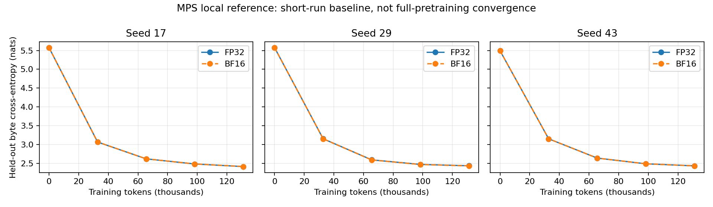

# G0-local review: Apple GPU baseline

**Status: awaiting user review. 40 of 41 automated criteria passed; the BF16
first-step parameter-update criterion failed. No threshold was changed and no
precision milestone is accepted. Dependent FP8/FP4 work is paused.**

## Scope and reproducibility

- Apple M5 Pro, 20 GPU cores, 48 GiB unified memory; macOS 26.6.
- Python 3.12.14 and PyTorch 2.15.0; full package versions in
  [environment.txt](environment.txt), with hashes pinned in the
  [dependency lock](../../../../tools/precision_local/requirements.lock).
- Independent MPS reference decoder: 3,541,248 parameters, 4 layers, width 256,
  4 attention heads, SwiGLU width 768, sequence length 128, dropout 0.1.
- Tiny Shakespeare at a fixed source revision and SHA256. Raw byte vocabulary
  256; first 90% of the text for training, last 10% for validation. Samples do not
  cross the split boundary. Validation uses 4 fixed batches, or 4,096 byte targets,
  sampled from the held-out suffix; it is not full-corpus evaluation.
- Seeds 17, 29 and 43; FP32/BF16 pairs have identical initial weights and training
  sample order. Batch size 8, 128 steps and **131,072 processed tokens per primary
  run**. Sampling may repeat or overlap text windows. AdamW, 8-step warmup and
  cosine decay; full settings and predeclared tolerances in
  [protocol.json](protocol.json).
- Model parameters, gradients and AdamW states stay FP32. Linear/attention GEMM
  operands use BF16 in the BF16 arm; normalization, softmax, residuals and loss
  remain FP32. The observed projection dtype is checked explicitly.
- Strict deterministic algorithms enabled; MPS CPU fallback and fast math
  disabled. Run source is
  [`15a2ba2ba`](https://github.com/jiaxi98/Megatron-LM/commit/15a2ba2baa93e36fad7149161af9c5b4ff363a4d),
  with a clean working tree. Post-run diagnosis is from
  [`9ef42ece2`](https://github.com/jiaxi98/Megatron-LM/commit/9ef42ece2a37e6b55612094258b434052739681d).

This validates the local reference and experiment machinery. It does not execute
Megatron/Transformer Engine, validate H20 kernels or parallelism, or establish
FP8/FP4 accuracy, long-horizon pretraining convergence, or downstream capability.

## Numerical results

The CPU FP32 reference and MPS candidates use the same inputs and initialization,
with dropout disabled for the single-step comparison. Errors are relative L2
norms of the complete flattened tensors. The update is the actual first AdamW
parameter delta, not the difference between full parameter values.

| Quantity | MPS FP32 vs CPU FP32 | FP32 bound | MPS BF16 vs CPU FP32 | BF16 bound |
| --- | ---: | ---: | ---: | ---: |
| Logits | 0.000000511 | 0.0001 | 0.00633280 | 0.03 |
| Gradients | 0.000000251 | 0.001 | 0.00584747 | 0.08 |
| Parameter updates | 0.0000336535 | 0.01 | **0.10269984 (failed)** | **0.10** |

BF16 update cosine similarity is 0.99472636. Its maximum absolute update
difference is 0.00119993, against an audit learning rate of 0.0006. Audit LR is
the configured base LR; the training loop separately applies warmup and decay.

## Short training and exact replay

All six primary runs had finite loss/gradient diagnostics, reduced validation
loss by more than the predeclared 0.3, and satisfied the 0.1 paired final-loss
bound. Cross-entropy values are in nats per byte target.

| Seed | FP32 final validation CE | BF16 final validation CE | Absolute gap | BF16 weights evaluated in FP32 |
| --- | ---: | ---: | ---: | ---: |
| 17 | 2.41375905 | 2.41417927 | 0.00042021 | 2.41418010 |
| 29 | 2.43508089 | 2.43266892 | 0.00241196 | 2.43260509 |
| 43 | 2.43290514 | 2.43340039 | 0.00049525 | 2.43340266 |

The maximum paired gap under common FP32 evaluation is 0.00247580. This small
experiment does not establish a statistical equivalence margin for large models;
the lower BF16 loss for seed 29 is not evidence of a quality improvement.

For seed 17, both precisions were separately repeated from initialization and
restarted from the serialized step-64 checkpoint in fresh processes. All four
comparisons were **exact** for the entire final checkpoint: parameters, optimizer
state, CPU/MPS/data RNG state, sample indices, loss/gradient/LR history, and
validation history. This is local replay evidence, not a distributed determinism
claim. Diagnostic runs are excluded from this exact-replay check.

## Failed update criterion: attribution

The post-run diagnostic reproduced the same 0.10269984 relative update error.
It found:

- 9,700 of 3,541,248 gradient coordinates changed sign: **0.273915%**.
- Those coordinates contributed **99.678173% of squared update-error energy**.
- Median absolute reference gradient on flipped coordinates was 0.00000199239,
  versus 0.000382738 across all coordinates.
- At the first AdamW step, after bias correction, the gradient contribution is
  `-lr * g / (abs(g) + epsilon)`. Common weight decay cancels between identical
  initial weights. The difference predicted from this expression matches the
  measured update difference with relative L2 residual **0.00000960100**.
- Error is distributed across multiple parameter tensors. The largest individual
  contributor, `blocks.3.up.weight`, accounts for about 7.16% of squared error.

This supports first-step Adam sensitivity to near-zero gradient sign changes as
the explanation for the relatively large update metric, despite small global
gradient error. It does **not** turn the failed criterion into a pass or prove
that the same behavior is harmless at other scales/training stages. Full
per-parameter results are in [update_diagnosis.json](update_diagnosis.json).

## Compatibility failure retained

The first attempt stopped during the audit because the standard MPS embedding
backward has no deterministic implementation in this environment. The reference
embedding now uses an equivalent FP32 one-hot GEMM for its 256-token vocabulary.
Exact forward values and repeated-token gradients are checked against CPU lookup.
Strict determinism and all thresholds were preserved. This choice adds work and
is not a production recommendation for large vocabularies.

The failed attempt and traceback remain under
`local/precision/runs/g0-local-v1`; their source revision and log hash are recorded
in [provenance.json](provenance.json).

## Evidence and reproduction

- [Machine-readable gate results and artifact hashes](metrics.json).
- [Source, dependency, protocol and report hashes](provenance.json).
- Complete successful-run artifacts:
  `local/precision/runs/g0-local-v1-attempt2` (about 766 MB of checkpoint/result
  evidence). These local artifacts are ignored by Git; compact evidence is
  committed here. Remote checkpoint storage has not been configured.
- Diagnostic artifacts: `local/precision/runs/g0-local-update-diagnosis`.
- Follow the [harness instructions](../../../../tools/precision_local/README.md)
  with new output directories to reproduce. The recorded run/diagnosis revisions
  identify the exact code for each command.
- 20 local tests passed. They cover causality, normalization reference values,
  gradient flow, dtype boundaries, byte-target alignment, full checkpoint replay,
  negative acceptance cases and first-step AdamW attribution. Formatting and
  fatal-error lint checks passed. CUDA/distributed tests were not executed.

Runtime records include compilation, synchronization, validation and checkpoint
I/O. Memory is sampled live MPS allocation. Neither is used to make native
FP8/FP4 throughput or memory claims, or to rank FP32/BF16 performance.

## User review

**Decision pending.** The implementation/replay evidence is strong for this local
scope, but the predeclared overall gate remains failed. Discuss whether to retain
the current update bound and investigate further, or define a prospective,
stage-aware update criterion with the user. A useful next diagnostic would cover
multiple steps and mature Adam moments at fixed checkpoints; it has not been run.
Do not retroactively relabel this run or start dependent FP8 work without the
user's decision. H20 G0 and G1-G4 remain pending.

Atomic implementation commits:

| Commit | Feature |
| --- | --- |
| `a5767deb6` | Isolated MPS environment and predeclared protocol |
| `bb265b21b` | Causal decoder reference and correctness tests |
| `aeb4aac63` | Training, numerical audit and complete checkpoint restoration |
| `5f6f38355` | Paired experiment orchestration, gate checks and curves |
| `15a2ba2ba` | Deterministic MPS byte embedding compatibility fix |
| `9ef42ece2` | First-step AdamW update-error attribution |
| `6bda76764` | Remove an unused diagnostic import; no numerical change |

All commits use `Jiaxi Zhao <jiaxi.zhao@u.nus.edu>`. This report is committed
separately from the implementations that produced its evidence.
